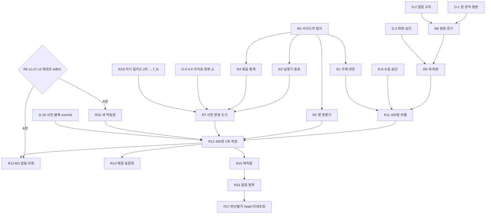

# 08. 수석 ML 엔지니어·기술 리드 — 통합 로드맵 (2026-11-26, Claude)

범위: 01~07 통합, 충돌 주장의 원본 재대조(읽기 전용 python 4건), 이 문서와 폴더 `README.md` 작성만 했다. 학습·추론·모델 비교·라벨 수정·외부 AI 호출·`./develop`·`./experiment`·`./review`·commit·push는 하지 않았다. 다른 파일은 고치지 않았다. 자기 일치도 새 1차 답(`artifacts/self-agreement-split-20261126/out1/`), 독립 350·봉인 468 원자료는 열지 않았다.

**결론 5줄**
1. **지금 개발 자료(942구역)로 낼 모델 가설은 없다.** 모델 쪽 근거가 있는 오류는 6/178구역이고, 라벨 흔들림 폭(결함 33·정상 44구역)보다 작다(04 2-1, 05 4-3, 06 2-5). 같은 자료의 모서리 모델 비교는 12회 중 2회만 통과했다(06 2-2).
2. **정확도의 첫 병목은 모델이 아니라 정답이다.** 사람 정답이 증명된 모서리 시험 자료가 없다. 재시험 A2·B2는 AI 최종 파일과 64/64가 같다(이번에 재대조). 옛 정상 라벨의 37%는 현행 기준으로 결함이다(02 2-5). 지금 보이는 오탐의 상당 부분은 이 기준 차이일 수 있다(04 2-2, 표본 12구역).
3. **지금 바로 할 일은 기록 도구 5개다.** 판정 주체 관문(사람/AI 판정 구분), 제외 건수·행 사실 기록, 실행기 층×점수 구간 표, 사진 묶음 통계, 연속 미달 계수다. 사용자 결정 없이 병렬로 구현할 수 있다(07 4-6). 이것으로 누락·오탐이 줄지는 않는다. 분모와 판정 주체가 보이게 될 뿐이다.
4. **진행을 막는 것은 네 가지다.** ① 11-27 v2 판정 주체 재대조, ② 희미한 흰 흔적 기준 결정, ③ 새 라벨 화면 변경 승인, ④ 독립 사람 자료 400장 수집 승인이다. 160장은 부족하다. 이번에 다시 계산해 400장이 맞음을 확인했다.
5. **모델 개선 후보는 자료 확보 뒤에만 시험한다.** 첫째는 단방향 라벨 잡음 보정(M3), 둘째는 배경 표준화(I3, 누락 기준만)다. 그 전에 400장으로 현재 모델을 1회 측정한다(새 기준 작동점과 판단 보류 출력 포함).

## 1. 이 분야에서 실제로 한 일

읽은 원문(전체): `00-BRIEF.md`, `01`~`07`(04 부록 표 369줄 포함), `AGENTS.md`(주입 전문), `docs/AGENT_START.md`(87줄). 부분 확인: `docs/collaboration/reports/corner-error4-cause-20261125.md:48-50`, 메모 `self-agreement-measure-plan.md:70`(11-27 예약 배치 문장).

원본 재대조(모두 `python3 -I`, 입력 변경 없음, 결과는 stdout뿐):
- **V1 B2 50/64 대 64/64.** `artifacts/cohort2-retest-20261125/responses/{A2,B2}.txt`의 `zN=값`을 같은 폴더 `ai-responses/screen-{A2,B2}-AI-{pass1,final}-20261125.txt`와 비교했다. 결과는 A2 pass1 56/64·final 64/64, B2 pass1 50/64·final 64/64다.
- **V2 03 대 04 배경 해석.** `artifacts/label-v2-20261124/overlay-100.json`(119구역), `artifacts/corner-size-threshold-20261123/measures.json`의 `status`, `artifacts/experiments/20261121T050740-8588eeb0/observations.json`의 target·점수를 id로 맞췄다. 0건 누락이다. 옛 정상 94구역 × 배경 × v2로 셌다.
- **V3 160장 대 400장.** 개발 256장의 칸별 구역 수(밝음 결함 185·밝음 정상 336·어두움 결함 187·어두움 정상 164, 03·04 표)와 05의 칸별 설계 효과로 칸별 필요 사진 수를 다시 계산했다. 설계 효과(DEFF)는 사진 안 구역끼리 닮아 생기는 분산 증가 배수다.
- **V4 "미채택 4회" 대 "12회 중 2회 통과".** `corner-error4-cause-20261125.md:50`을 확인했다.

## 2. 발견 — 충돌 주장 판정

| # | 충돌 | 원본 대조 결과 | 판정 |
|---|---|---|---|
| C1 | 03: 밝은 배경 정상 라벨에 놓친 결함이 섞였다 vs 04: 반대 방향 | **V2**: 옛 정상 → v2 결함은 밝음 20/59(33.9%), 어두움 15/30(50.0%)다. 끝 잘림 1·테두리 없음 4는 모두 정상이었다. 모델이 표시한 옛 정상은 밝음 6(결함 4·정상 2), 어두움 6(결함 6)이다. 04 수치와 정확히 같다 | **04 채택.** 03의 라벨 쪽 해석은 지지되지 않는다. 다만 두 비율의 구간이 겹치므로(04 2-3) "반증"이 아니라 "지지 안 됨"이다. 03의 누락 쪽 근거(밝음 누락 52/185 대 어두움 28/187, 사진 부트스트랩 구간이 0을 넘음)는 남는다. 그래서 I3의 성공 기준은 **누락만** 쓴다 |
| C2 | 04: 새 독립 자료 약 160장 vs 05: 380~440장 | **V3**: 식 n = 1.96²×0.3×0.7/0.08² = 126.05구역이다. 칸별 필요 구역 = 127 × DEFF다. 사진당 칸 수율로 나누면 기댓값 기준 밝음 결함 202, 밝음 정상 118, **어두움 결함 323**, 어두움 정상 242장이다. 제외 8%를 더하면 최대 352장이다. 04의 157.5장은 결함 합계만 본 값이다 | **05 채택, 400장.** 기댓값만으로도 350장이 넘는다. 네 칸이 모두 목표를 채울 확률이 0.96인 장수가 400이다(05 모의). 160장으로는 카드 단위 A/B 감지력도 0.003~0.26이다(05 2-4) |
| C3 | 02: B2 AI 동일 64/64 vs 되돌린 보고서: 50/64 | **V1**: pass1 50/64, final 64/64다. 대조한 AI 파일이 달랐다 | **둘 다 사실이다(07 O3와 같다).** 판정은 "AI 동일"이다. 그래서 관문(X3)은 AI 파일을 모두 대조해 파일별로 기록해야 한다. 최댓값 하나만 남기면 안 된다 |
| C4 | 04: 같은 942에서 미채택 4회 vs 06: 개발 자료 모서리 비교 12회 중 통과 2 | **V4**: 04의 근거 줄은 "네 배치 평균 이후 942구역에서 3회 + 두 번째 패치 1회"다 | **범위가 다를 뿐 둘 다 맞다.** 과적합 위험은 더 넓은 06의 횟수(12회)로, 연속 미달은 942의 마지막 3회로 센다 |
| C5 | 05 4-3: 주 지표 = 구역 오탐(추천) vs 06 M3: 주 지표 = 새 기준 구역 누락 | 원문 대조(05:177, 06:229). 04에서 누락의 라벨 쪽 근거는 0구역이고 오탐은 기준 차이에 몰려 있다(04 2-2) | **가설마다 겨냥한 지표를 사전에 주 지표로 정하고, 기본값은 구역 누락으로 한다.** 오탐은 기준 정본(D-1)이 정해진 뒤에만 주 지표로 쓸 수 있다. 결정 D-4에 넣었다 |
| C6 | 02 L2: 잡음 폭 = f 상한 × 분모 전체 vs 05: 2×⌈f×m⌉, m = 두 모델이 갈린 구역 | 식을 비교했다(원본 수치 불필요). 무작위 뒤집힘은 갈린 구역에서만 b·c를 바꾼다 | **05 채택**(판정 폭). 02 식은 계획 관문 ③(라벨 흔들림 장수)에만 쓴다 |
| C7 | 01 F8: 관찰 불가 하한 0.13mm vs 03: 0.26mm | 03 2-5: 라벨 화면 중앙 7.7 px/mm다 | **03 채택**(라벨을 만든 화면이 기준). 분모에서는 빼지 않고 흰 크기 층으로만 나눠 보고한다(05 4-1 ⑤) |
| C8 | 01 G1: 판단 불가 15% 문턱 vs 02: 칸 평균의 2배 | 02 2-1: 현재 미확인 1.3~3.1%라 15%는 발동하지 않는다 | **둘 다 둔다**(05 4-1·4-4와 같다). 2배 규칙은 신호를, 15%는 절대 상한을 맡는다 |
| C9 | 05: 400장은 측정 전용 vs 06 (나): 후보를 미리 동결해 같은 자료로 측정과 A/B를 함께 | 원문 비교. D3 첫 시험이 동결 방식이었다 | **사용자 결정 D-9.** 추천은 아래에 적었다 |

## 3. 해야 할 일 — 통합 목록 (중복 제거)

담당 형태: **구현** = 구현 task(`./develop` 안), **결정** = 사람 결정, **라벨** = 사람 라벨, **확인** = 사람 확인. 단계: 0 = 지금 바로, 1 = 사용자 결정 후, 2 = 자료 확보 후.

| ID | 할 일 | 합친 원 항목 | 기대 효과(근거 수치) | 사람 의존 | 병렬 | 담당 | 단계 | 우선 |
|---|---|---|---|---|---|---|---|---|
| R0 | 사이드카 형식 고정(`exclusions`·`row_facts`·`bands`·사전 판정) | 07 T0 | 아래 R1~R5의 공통 계약 | 없음 | **먼저 단독** | 구현 | 0 | 상 |
| R1 | 판정 주체 관문 `tools/rater_gate.py`: 모든 AI 파일과 대조해 k/n·우연 기준선·시각을 남기고, 판정자 칸을 고정한다 | 02 L1·L7, 07 X3 | 정답 유효성. AI 동일 사례: 봉인 점검 화면 2~5 64/64, A2·B2 64/64, 350 중 131, 468 중 416(02 2-3) | "AI 의심" 처리(D-7)는 칸 이름에만 영향 | R2·R3·R4와 병렬 | 구현 | 0 | 상 |
| R2 | 행 변환기 `tools/zone_rows.py`: 4상태를 받고, 모르는 상태는 거절하고, 제외 건수·층·주체·기준 판본을 사이드카로 낸다 | 02 L3·L4, 03 I1(원천), 04 E4, 05 S1, 07 X1 | 분모 치우침 노출. D2 모서리 44/552 = 8.0% 제외, 표면 `center` 미확인 9.6%(02) | 없음 | 병렬 | 구현 | 0 | 상 |
| R3 | 실행기 사이드카와 층×점수 구간 표(`experiment_sidecars.py` + 기존 함수 2줄). 보류 비율·문턱 근처·배경 층을 한 표로 낸다. 사용 횟수와 엣지 잡음 미측정 표기 포함 | 03 I1, 04 E3, 05 S6, 06 M2(보고 칸), 07 X2, 02 L6 | 개선 착시 차단. 배경 누락 28.1% 대 15.0%, 문턱 ±0.1 안 누락 29%·오탐 39%(04), 보류 36%(06) | 없음(main 통합은 고지 후 승인) | 병렬(`experiment_record.py` 단독 소유) | 구현 | 0 | 상 |
| R4 | 사진 묶음 통계 도구: DEFF 보정 Wilson, 사진 부트스트랩, 사진 단위 순열 검정 | 05 S2, 07 X6 | 우연 개선 차단. 구역 구간이 DEFF 1.2~1.9배 좁게 나온다(05 2-2) | 없음 | 병렬 | 구현 | 0 | 상 |
| R5 | 연속 미달 계수 도구 | 07 X7 | `stop-repeated-misses` 실측(942 마지막 3회) | 없음 | 병렬 | 구현 | 0 | 하 |
| R6 | 11-27 v2 판정 주체 재대조 결과를 확인하고 분기 A/B/C를 기록한다 | 02 L5 일부, 04 2-2, 05 4-3, 06 M1·M3 | 04 2-2·06 2-3 전체와 ρ의 유효성이 여기에 달렸다 | 예약 배치(읽기 전용, 실행 미검증, 메모 :70). 확인 문장 일치는 사용자 진술 필요 | 독립 | 확인 | 0 | 상 |
| R7 | 사전 판정 블록(05 4-3)을 사후 적용하는 도구. 분기 A/B/C와 실패 문장 포함 | 05 S3, 07 X5, 02 L2, 04 E1 | 결과를 본 뒤 기준 변경 차단 | D-3·D-4·D-5 | R3·R4 뒤 **직렬** | 구현 | 1 | 상 |
| R8 | 정본 문구 갱신(흰 흔적·위치 경계·걸침). 순서: 정본 → 다른 점 표 → 화면 | 01 G2·G3 | 분모 안정. 판단 불가 처리만으로 분모가 11~16% 변한다(01 F1) | **D-1·D-2** | R9와 같은 묶음 | 결정 → 문서 | 1 | 상 |
| R9 | 새 모서리 화면: `판단 불가` 상태, 원본 해상도(≥ min(원본, 15.27) px/mm), 화면 조건 `.criteria.json` 기록 | 01 G1·G5, 03 I2, 07 X4 | 판단 불가 0/9,017 해소. 라벨 화면 7.7 대 모델 14.7 px/mm(03). 0.14~0.26mm 흔적의 오탐 계상을 줄일 수 있다(**가정, 미측정**) | **D-3** | 승인 뒤 병렬 | 구현 | 1 | 상 |
| R10 | 새 기준 작동점 규칙 기록(M1, 측정용). 모델은 바꾸지 않는다 | 06 M1 | v2 0.5에서 누락 33/60 = 55%. 대부분 눈금 문제다(AUC v1 0.873 대 v2 0.891). **곡선을 이미 본 탐색** | **D-8**, R6 = A | 독립 | 결정 + 기록 | 1 | 상 |
| R11 | 독립 사람 시험 자료 400장: 수집, 빈 화면 라벨, 주체 관문, 같은 판정자 재판정 부분 표본, 판매자 ID | 04 E2·E5·E6, 05 S4·S7·S8, 03 I6(안내만) | 층별 비율 ±0.08 달성 확률 0.96(05). 판단 불가 66구역의 원인을 새 자료로만 확인(04) | **D-6** 승인, **라벨** | 수집은 R1~R4와 병렬 | 라벨 | 2 | 상 |
| R12 | 400장 1회 측정(현재 채택 모델, 0.5 + M1 작동점 + 보류 출력 + 층) | 05 4-4, 06 M1·M2, 04 E2 | 첫 "사람 정답 대비" 일반화 수치. 개선 주장이 아니라 측정이다 | R11, D-10 commit | 직렬(R1~R4·R7·R11 뒤) | 구현(기본 checkout 담당) | 2 | 상 |
| R13 | 단방향 라벨 잡음 보정 손실 M3(ρ = 35/94, 고정). 지금은 계획서만, 실험은 R12 뒤 | 06 M3 | 새 기준 누락 감소 기대. 근거: 옛 정상 37%(28.1~47.3)가 결함, 옛 결함은 0/25가 뒤집힘. **효과 크기는 미측정** | **D-9**, R6 = A | 계획서는 지금 가능 | 결정 → 구현 | 계획 0 / 실험 2 | 중 |
| R14 | 배경 표준화 I3(실루엣 밖을 회색으로). 성공 기준은 누락만(C1) | 03 I3 | 밝은 배경 누락 52/185 감소 기대. 선행 검사: 흰 화소가 잘리는 비율 ≤5%, 마스크 성공 ≥85% | 실험 승인 | R13과 다른 변수라 별도 실험 | 구현 | 2 | 중 |
| R15 | 새 기준 라벨로 head 재적합, 두 번째 독립 자료로 평가 | 06 M4 | 학습·평가 정답 기준 일치 | 수집 승인 | 직렬 | 라벨 + 구현 | 2 | 중 |
| R16 | 끝점 기준 범위: 입력 창(I4)과 집계 범위(M5) 중 **하나만** | 03 I4, 06 M5 | 테두리·배경 경계 오탐. 둥근 끝은 칸의 약 2%(03) | D-2 | 직렬 | 구현 | 2 | 하 |
| R17 | 판단 불가 학습 head, 백본 미세조정 | 06 M6·M7 | 미지 | R9로 쌓인 판단 불가 라벨, 큰 자료 | 직렬 | 구현 | 2 | 하 |
| R18 | 자기 일치도 2차(12-03~12-10) → f_hi를 판정 폭에 적용 | 02 L2, 05 4-3 | 판정 폭 확정. 측정 전 임시 f_hi는 0.081 | 2차 판정(이미 승인) | 독립 | 라벨(진행 중) | 0~1 | 상 |
| R19 | 진단 잔여: 표면 `center` 미확인 원인, 픽셀 반사·화이트밸런스, 카드 작동점 출처, 엣지·표면 행 단위 분류, 350/468 원자료 재대조 | 02 L5·L8, 03 I7, 05 S9, 04 E7 | 원인 확인 | 일부 열람 승인 | 병렬 | 구현/확인 | 1 | 하 |
| R20 | 관찰 제한 단위, 인쇄 결함·재단 거칠기·옆면 흰 띠, 슬리브 반사의 지위 | 01 G4·G6·G7 | 엣지·표면 오탐, 관찰 제한 경계 | D-11 | — | 결정 | 1 | 중~하 |

하지 않을 것(01~07 합집합): 같은 942구역으로 새 모델 변형을 판정하는 일, 06 2-2 재시도 금지 목록, 모델 결과로 고른 구역 재판정, v2로 v1 교체, 문턱 이동을 향상으로 보고, 보류 비율 없이 남은 구역만 보고, 160장으로 카드 A/B, 판단 불가·미확인을 채운 분모, 실행기 판정 문턱 0.5 변경.

## 4. 설계 — 의존 그래프와 로드맵

### 4-1. 의존 그래프 (무엇이 무엇을 막는가)

막힘 요약:
- **R6(11-27 재대조)** 결과가 B·C이면 R10·R13이 멈춘다. 04 2-2와 06 2-3의 수치는 기술용으로만 남는다. 05의 엄격 기준 장수(약 420장)는 근거를 잃는다(400장은 그대로).
- **D-1·D-2(기준) → R8 → R9 → R11.** 기준이 정해지기 전에 400장을 라벨하면 또 다른 기준 판본이 섞인다. 이것이 가장 비싼 병목이다.
- **D-10(commit)** 없이 R12를 하면 사전 고정의 증거가 파일 첫 저장뿐이다(05·06·07이 모두 밝혔다).
- R1~R5는 아무것도 기다리지 않는다.

### 4-2. 단계별 로드맵

**0단계 — 지금 바로 (사용자 결정 불필요)**
1. R0 → R1·R2·R3·R4 병렬 구현(R5는 여유가 있을 때). 회귀 기대값은 01~07 수치를 그대로 쓴다. 예: D2 508행·제외 44, A2·B2 64/64와 pass1 56·50/64, 배경 52/185·39/336, DEFF 1.33·1.44. 이 수치가 지금은 scratchpad 스크립트에만 있으므로(07 2-2) 이 회귀가 곧 재현 장치다.
2. R6: 11-27 예약 배치 결과를 확인하고 분기를 기록한다. 배치 실행은 미검증이라, 결과가 없으면 같은 읽기 전용 대조를 다시 요청한다.
3. R13 계획서만 쓴다(ρ·성공 기준·반증 조건 고정, 학습 없음).
4. 아래 5절의 결정 묶음을 사용자에게 한 번에 제시한다.
- 통합 규칙: 구현은 기존 개발 승인 범위에서 한다. main 통합·push는 고지한 뒤 승인을 받는다(메모 `ask-before-integrate-push`).

**1단계 — 사용자 결정 후**
1. D-1·D-2 → R8 정본 문구 → D-3 → R9 화면(4상태 왕복 시험 포함).
2. D-3·D-4·D-5 → R7 사전 판정 도구 → D-10 사전 블록 commit.
3. R6 = A이고 D-8이면 R10 작동점 값을 계산해 기록한다(측정용, "기준 진단").
4. D-6 → R11 수집 계획 확정(판매자 ID 필드 확인 포함).

**2단계 — 자료 확보 후**
1. R11 라벨(빈 화면, 주체 관문 통과) → R12 400장 1회 측정. 이것이 첫 사람 정답 대비 수치다.
2. R18 f_hi가 확정되면 판정 폭(N_noise = 2×⌈f_hi×m⌉)을 교체한다.
3. R13 개발 단계(v2 119구역 방향 점검, "우연 가능") → D-9 방식으로 독립 A/B. 그다음 R14(누락 기준).
4. R15 → R16 → R17.

### 4-3. 병렬 가능 묶음

| 동시에 가능 | 이유 |
|---|---|
| R1 ∥ R2 ∥ R3 ∥ R4 ∥ R5 | 새 파일만 쓰고 파일이 겹치지 않는다. `experiment_record.py`는 R3만 소유한다(07 4-6) |
| 0단계 구현 ∥ R6 ∥ R18 ∥ 사용자 결정 | 서로 입력이 없다 |
| R9 ∥ R7 | 파일이 겹치지 않는다(결정 뒤) |
| R13 ⟂ R14 | 같은 자료로 동시에 하면 변수가 두 개가 된다. **직렬로 한다** |

## 5. 사용자 결정 목록 (추천안 1개 + 이유)

> 2026-11-27 확정: D-1·D-2·D-3·D-4·D-5(Δ)·D-6(400장)·D-10. 세부 범위와 미결정 항목은 [DECISIONS.md](DECISIONS.md).

핵심(진행을 막음):

| # | 결정 | 추천 | 이유 |
|---|---|---|---|
| D-1 | 희미한 흰 흔적 처리 | **(A) 구분되는 흰 흔적은 크기와 관계없이 결함, 반사/마모 구분이 안 될 때만 판단 불가.** 표면·엣지에도 적용 | 11-24 모서리 결정(B2)과 같은 방향이다. 판단 불가를 좁히면 분모 변동(11~16%)이 줄어든다(01 G2) |
| D-2 | 둥근 끝·직선 엣지에 걸친 자국 | **걸친 두 위치 모두 결함** | 누락 우선 결정과 맞다. 호 접점·테두리 같은 기하 기준만 쓰므로 mm 문턱 폐기와 충돌하지 않는다(01 G3) |
| D-3 | 새 모서리 화면 변경(판단 불가 상태 + 원본 해상도 + 조건 기록) | **승인** | 400장 라벨 전에 필요하다. 지금 판단 불가 0/9,017, 화면 해상도는 모델의 약 1/2이다. 완료 라벨 재요청은 아니다. 휴대폰 용량 제약은 화면당 장수로 조절한다 |
| D-4 | 주 지표 단위와 방향 | **구역 단위 + 사진 묶음 순열 검정. 주 지표는 가설이 겨냥한 쪽으로 사전 지정하고 기본은 구역 누락** | 카드 단위는 160장에서 감지력 ≤0.26이고 엄격 기준에서는 정상 카드가 부족하다(05). 누락은 라벨 쪽 근거가 0이라 기준 혼입이 작다(04) |
| D-5 | 판정 판본 V와 반대 지표 비열등 한도 Δ | **V = 11-24 모서리 정본(+D-1 반영), Δ = 0.05** | Δ0.03은 결함 110장에서 통과 확률 0.29~0.45로 시험이 되지 않는다. Δ0.05는 0.60~0.84다(05 2-4). 허용할 악화 폭 자체는 사람의 가치 판단이다 |
| D-6 | 독립 자료 수집·라벨 | **사진 400장. 같은 판정자 재판정 부분 표본은 약 10%(40장), 7~14일 간격. 판매자 상한은 판매자 ID 확인 뒤 결정** | 400장은 C2 재계산과 05 모의로 확인했다. 간격은 자기 일치도에서 확정한 값이다. 판매자 상한은 지금 근거가 없다 |
| D-10 | 사전 블록(05 4-3, 06 M1~M3, 07 4-1, 이 문서) commit | **R12 점수 공개 전에 승인** | 결과 전 고정을 증명할 유일한 방법이다(05·06 "첫 저장뿐") |

보조(지금 안 정해도 0단계는 진행):

| # | 결정 | 추천 | 이유 |
|---|---|---|---|
| D-7 | 관문의 "AI 의심" | **주 분모에서 빼고, 라벨은 AI 판정 저장소에 보관한다(삭제 안 함)** | 목표 정답은 사람 판정이라는 11-26 결정이 있다. 05 4-1 ③과 같다. 62/64는 우연 기준선(약 59%)을 크게 넘는다 |
| D-8 | 새 기준 작동점 규칙 | **(A) 누락 상한 규칙**(v2 누락 Wilson 상한 ≤30%) | 누락 우선 결정과 맞다. 곡선을 이미 본 노출은 계획에 적는다(06 M1) |
| D-9 | M3 ρ 사용과 자료 방식 | **ρ 사용 승인(R6 = A일 때만). 400장은 기본 측정 전용 (가). 단, 점수 공개 전에 M3 개발 단계가 통과하고 실제 b·c로 계산한 감지력이 ≥0.80이면 (나) 동결 동시 측정** | 사람 라벨 자체는 바꾸지 않는다. 자료를 소진하지 않는 것이 우선이고, 조건이 맞을 때만 자료를 아낀다 |
| D-11 | 관찰 제한 단위·인쇄 결함·재단·옆면 흰 띠·슬리브 | **관찰 제한은 "구역은 판단 불가 + 사진은 제한" 둘 다(01 G4). 나머지는 D-2 뒤로 보류** | 재현성 불일치 6건이 모두 부분 가림 경계였다. 나머지는 사례 근거가 없다 |
| D-12 | 350·468 원자료 재대조, 운영 문구(보류 출력·촬영 안내) | **보류** | 350은 소진됐고 468은 AI 동일이 416이다. 400장이 대체한다. 운영 문구는 PokeCollector 범위 밖이다 |

사람 확인(결정 아님): R6의 확인 문장이 기록과 맞는지, R18 2차 판정.

## 6. 주의 — 과장되기 쉬운 주장

| 주장 | 왜 과장되기 쉬운가 | 쓸 때 붙일 문구 |
|---|---|---|
| "오탐의 대부분은 라벨 탓"(04: 83%, 외삽 74구역) | 표본 12구역(Wilson 55~95%)이다. 개발 자료의 부분집합이고, 11-27 재대조 전이다 | "개발 표본 탐색, 주체 재대조 전, 일반화 금지" |
| "새 기준에서 순위는 유지, 눈금만 어긋남"(06: AUC 0.891, 작동점 0.30) | 같은 119구역에서 곡선을 본 뒤 읽었다. AUC 차이 구간은 −0.066~+0.099다 | "탐색, 개선 주장 아님, 측정용 기준 진단" |
| "배경이 가장 강한 오류 층"(03·04) | 결과를 본 뒤 나눈 층이다. 판매자·시대 혼입을 분리하지 못했다 | "사후 분할 탐색. 새 자료에서는 사전 층으로만" |
| 942 개발 자료에서 무엇이든 통과 | 14회 재사용했고 모델 비교는 12회 중 2회 통과다 | "개발용, 우연 가능, 일반화 미확인" |
| 독립 350·봉인 468·11-21 재판정·합의 240 수치 | AI 판정이 섞였거나 AI 산출과 같다 | "AI와의 일치율"(사람 정답 대비 아님) |
| v2·W1 "사람 기록" | 확인 문장 불일치 기록이 있다(04 2-2). 증명이 아니다 | "사람 기록(증명 아님)" |
| 라벨 잡음 f ≈ 2% | 같은 크롭을 8~9시간 뒤에 다시 본 값이라 기억 효과로 하한이다. 주체도 미확인이다 | "하한, 임시값 f_hi 0.081" |
| 에이전트 관찰 "보임/안 보임" | 사람 라벨이 아니다(`QUALITY_RULES.md:83`) | 사진 조건 표시로만 |
| 보류·작동점으로 남은 구역 오류 감소 | 문턱 근처를 빼면 당연히 줄어든다 | 보류 비율과 항상 함께 쓴다 |
| 01~06 집계 수치 전반 | 스크립트가 세션 scratchpad에만 있어 저장소에서 재현할 수 없다(07 2-2) | R1~R4 회귀로 옮기기 전까지 "재현 미검증" |
| 0단계 도구 완료 | 기록이 보이게 될 뿐 누락·오탐 감소가 아니다 | "정확도 변화 없음" |

## 7. 앞 담당 의견에 대한 반박/보완

- **02의 "L1을 G1~G3보다 먼저"에 동의하되 병렬로 바꾼다.** L1(R1)은 구현이고 G2·G3은 사람 결정이라 서로 막지 않는다. 둘 다 R11(400장)의 선행이다.
- **03 I2(고해상도 화면)를 01 G1·07 X4와 한 승인(D-3)으로 묶었다.** 화면 변경은 모델 실험이 아니므로 변수 하나 규칙의 대상이 아니다. 대신 03의 지적대로 새 화면 라벨과 옛 라벨의 결함 비율을 비교해 "개선"이라 부르지 않는다.
- **06 M1(작동점)과 07의 실행기 문턱 고정은 충돌하지 않는다.** M1 값은 R3의 `bands`에 기술 칸으로만 들어간다. 실행기 판정 0.5는 그대로다(07 5절).
- **04 E1(이중 기준 오탐 보고)은 R3·R7에 흡수했다.** v2 칸은 분기 A일 때만 남기고, B면 지운다(05 분기 표).
- **06 결론 3(판단 보류 출력)은 R3 보고 칸으로만 지금 한다.** 운영 출력 변경은 D-12로 보류한다.
- **05 S7(판매자 ID)은 R11 수집 계획의 필수 칸으로 올렸다.** 판매자 묶음이 있으면 감지력이 과대 추정된다.

## 8. 미확인·다음 담당에게

- 미확인: 11-27 예약 배치의 실제 실행 여부와 결과(메모상 "실행 미검증"), 개발 946행 `rows.json` 생성 코드, 엣지 `need_ok=False`의 의도, 판매자 ID 필드의 존재, 새 자료의 배경 구성.
- 미측정: M3·I3의 효과 크기, 0.14~0.26mm 흔적의 오탐 기여, 엣지 구역 라벨 잡음, 백본 미세조정 효과.
- 이 로드맵은 모서리 중심이다. 엣지·표면은 R2·R3 기록과 R19 행 단위 분류 뒤에 같은 틀로 다시 짠다.

## 적용 품질 규칙

적용한 규칙: `short-request-reading`, `chance-check`(6절), `can-this-experiment-tell`(결론 1), `fresh-labels-test-first`(R12), `label-provenance`, `single-source-criteria`(R8 순서), `error-cause-triage`(04·06 분류를 그대로 사용).

못 지킨 것: 사전 고정은 commit 금지라 이 파일의 첫 저장으로만 남는다.

추가한 점검: 충돌 4건을 원본으로 재대조했다(V1~V4). 05·06 사이의 주 지표 충돌(C5)을 새로 찾아 결정 D-4에 넣었다.

## 롤백

이 파일과 `README.md`를 삭제한다. 다른 파일은 바꾸지 않았다.
