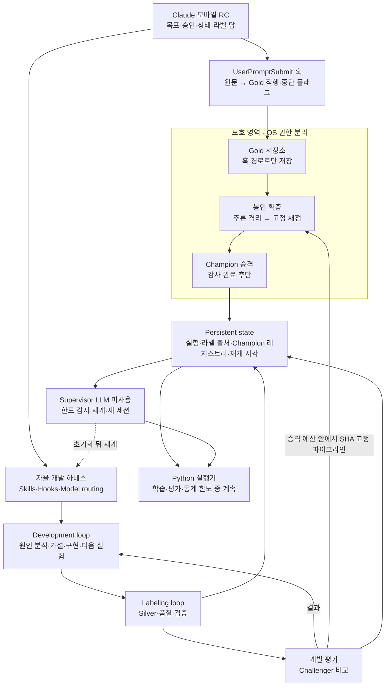

# 자율 개발 하네스 최종 설계 (5판 확정본)

작성 2026-11-27(KST), Claude. 상태: **설계 확정, 구현 미승인.** 이 문서는 권한을 새로 주지 않는다. 구현 착수 조건은 [IMPLEMENTATION.md](IMPLEMENTATION.md) 0절의 사용자 결정이다. 결정과 근거는 [DECISIONS.md](DECISIONS.md), 원자료 수치와 경로는 [EVIDENCE.md](EVIDENCE.md)에 있다.

## 1. 목표와 범위

- 사용자가 잠들어 있거나 데스크톱에 접근할 수 없어도 에이전트가 스스로 개발·자동 라벨링·학습·평가·다음 가설 생성을 반복한다.
- 단기·주간 사용량 한도가 초기화되면 새 사용자 메시지 없이 개발을 이어간다.
- 사람 정답 대비 결함 누락·오탐 감소를 독립 평가로 증명한다. 합의한 목표에 도달하면 정상 종료한다.
- 범위 밖: PokeCollector 운영 코드 반영(별도 승인), 유료 전환·한도 우회·계정 전환(금지), 센터링(v1.11에서 제외, 재도입은 범위 변경 승인).

## 2. 원칙

1. **정답 보호.** 평가 정답(Gold)은 사람만 만든다. AI 라벨은 어떤 검증을 거쳐도 Gold가 되지 않는다. 판정자가 1명이므로 수치는 "그 판정과의 일치율"로 표기한다.
2. **출처는 생성 과정으로 판단한다.** AI 판정과의 결과 일치는 출처 감사를 시작하는 경보일 뿐 제외 근거가 아니다. 제외는 과정 증거(예: AI 출력을 붙여넣은 기록)가 있을 때만 한다.
3. **판단 보류는 사람 확인 경보로 센다.** 분모에서 빼지 않는다.
4. **탐색은 느슨하게, 확증은 엄격하게.** 개발 자료 탐색은 지금 바로 한다. 확증은 사전 등록 후 봉인 평가 1회다.
5. **자동화는 목적이 아니고, 정답 보호도 자율 개발을 불필요하게 막는 수단이 아니다.** 성과는 같은 평가 자료·같은 분모에서 측정한 누락·오탐 감소뿐이다.
6. **Claude Code 기본 기능을 먼저 쓰고**, 기본 기능으로 안 되는 것만 직접 만든다(15절).
7. 기존 AGENTS.md 규칙(`./experiment`, `./develop` 잠금, 변수 하나, 학습/평가 분리, 완료 라벨 재요청 금지, 미확인 추정 금지, 모델 오답으로 사람 정답 변경 금지)은 그대로 적용한다. 충돌하는 문장은 [DECISIONS.md](DECISIONS.md) D-1로 개정 승인을 받는다.

## 3. 구조



| 구성 요소 | 권한 영역 | 책임 |
|---|---|---|
| Claude 모바일 RC | 사람 | 목표·승인·상태 확인·라벨 답 제출 |
| RC 조작 세션 | 에이전트 | 작업 요청·의사결정. 무거운 작업은 하지 않는다 |
| `UserPromptSubmit` 훅 | 결정론 | 사용자 원문을 모델보다 먼저 받아 Gold 저장·중단 플래그 기록 |
| Supervisor (launchd + Python) | 결정론 | 큐 배정, 작업권, 의존 그래프 대조, 한도 감지, `resetsAt` 뒤 재개, 예산, 알림 |
| Claude 실행기 (`claude -p`) | 에이전트 | 분석·가설·구현·Silver·능동 학습 해석 |
| Python 실행기 | 결정론 | 학습·평가·통계·능동 학습 점수. Claude 없이 동작 |
| Gold 저장소 (`cardeval`) | 보호 | 추가만 가능. 봉인 묶음과 보정(조정용/확인용) 묶음 분리 |
| 최종 평가기 (`cardinfer` → `cardeval`) | 보호 | 추론 격리 → 고정 채점. 지표만 반환 |
| Persistent state | 결정론 | 작업 큐, 해시 체인 장부, 모델 레지스트리, 재개 시각 |

## 4. 자율 루프와 트리거

사람 지시 없이 다음 연쇄가 작업 템플릿으로 자동 등록된다.

```
EXPERIMENT_VERIFIED
  → ANALYZE (Claude: 결과 해석, 다음 가설, 라벨 필요 판단. 입력은 ./experiment가 남기는 development_handoff.json의 next_steps)
  → PLAN_GATE (결정론: 변수 하나, 사전 등록, 실패 장부의 기각 가설 거절, 예산)
  → 다음 EXPERIMENT 또는 AL_SELECT
AL_SELECT → SILVER_QUEUE | HUMAN_QUEUE
SILVER_GEN → QUALITY_GATE → APPROVED | PENDING
APPROVED → TRAIN_CHALLENGER → DEV_EVAL
DEV_EVAL → (승격 조건 충족) CONFIRMING → CHAMPION | REJECTED
CHAMPION → 목표 판정 → (충족) REGRESSION_CHECK → REPORTED → DONE / (미달) ANALYZE
```

원인 재분석이 해결되지 않으면 라우팅 정책에 따라 상위 모델(예: Sonnet → Opus)로 올린다. 사람 판단은 승인 범위를 벗어나는 다음 행동(라벨 기준 변경, Gold 재라벨, 새 자료 수집, 제품 범위 변경)에만 요구한다. 재분석 결과는 가설이며 실험 관문을 통과해야 채택된다.

## 5. 라벨링: 등급, 수집, 자동 라벨링, 독립 교차 검증

### 5-1. 등급

| 등급 | 정의 | 사용 범위 |
|---|---|---|
| Gold | 훅 경로로 받은 사람 판정, 예측 없는 빈 화면, 과정 기록 완비 | 봉인 평가, 보정 평가, 개발 평가 |
| Gold-adjudicated | AI 감사를 본 뒤 사람이 다시 본 판정. 원본 Gold 보존 | 보정·분석. 최종 평가에는 원본만 |
| 출처 미상 | 과정 기록이 불충분한 기존 라벨 | 개발 평가. 학습에서 넣고 빼는 것은 하나의 실험 변수로만 다룬다(현재 학습 구성은 기준선으로 유지) |
| Silver | AI가 먼저 생성, 승인된 정책 범위에서 품질 관문 통과 | 학습에만 |
| Pending | 판단 불가, 품질 미달, 미검증 | 학습·평가 제외, 정상·결함으로 추정 금지 |

### 5-2. Gold 수집 경로 (에이전트를 거치지 않음)

1. 보호 스크립트가 화면 ID와 일회용 nonce를 발급하고 발급 기록을 먼저 남긴다. 화면에는 예측이 없고 "직접 판정" 확인 칸이 있다. 화면은 휴대폰 제약(정적 HTML, 클립보드 API·localStorage 없음)을 따른다.
2. 사용자가 채팅에 답을 붙여넣는다(기존 형식 `# 화면=`, `zN=값` 유지).
3. `UserPromptSubmit` 훅이 모델보다 먼저 원문을 받아 보호 저장소에 넘긴다. 함께 남길 것: 원문 해시, 화면 ID, nonce, 수신 시각, 판정 주체 확인값.
4. 발급되지 않은 nonce, 재사용 nonce, 형식 오류는 거절한다. 훅이 없으면 저장하지 않는다(fail-closed).
5. **한계:** 같은 사용자 권한의 에이전트가 훅 설정을 지우거나 nonce를 읽어 위조하는 것은 완전히 막지 못한다. 목표는 옮기는 과정의 사고 방지와 위조 감지(Claude 대화 기록 원본 대조)다.

### 5-3. 자동 라벨링 (Silver)

- 전략: 평가 Gold는 Human-first, 학습 Silver는 Agent-first.
- Silver 정책은 `(결함 유형, 층, 라벨 값)` 범위로 승인한다. 승인 조건은 보정 확인용 묶음에서 오류율 상한이 기준 이하(D-3)다. 첫 검증은 탐색 첫날 50~100구역 규모로 시작한다.
- 승인된 범위 안에서는 매번 사용자 승인을 받지 않는다.
- 예측을 미리 채운 라벨 화면은 금지한다(앵커링 실측: 미리 채운 90구역 중 변경 0).
- 봉인 이미지에는 Silver를 만들지 않는다.

### 5-4. 독립 교차 검증 (Silver 품질)

- **사람 기준 대조:** Silver를 보정 묶음 Gold와 대조한다. 보정 묶음은 조정용과 확인용으로 나눠 조정용에 맞춘 정책을 확인용으로 판정한다(보정 과적합 방지). 사용 횟수를 기록한다.
- **사람 감사 (위험 기반·비동기):** 새 정책의 처음 몇 회차는 높은 비율로 감사하고, 누적 감사 오류율 상한이 기준 아래면 낮춘다. 최저 2%는 **제안값**이며 실제 오류율·표본 수·위험도로 조정하고 조정할 때마다 장부에 남긴다. 분포 변화나 Champion–Silver 불일치 급증 시 비율을 다시 올린다. 감사 0%는 금지(판정자 1명이라 사람 감사 없이는 기준 이탈을 감지할 수 없음).
- **비동기 규칙:** 감사 중에도 탐색과 학습은 계속한다. **필요한 감사가 끝나기 전에는 Champion 승격을 허용하지 않는다.** 감사에서 실패하면 그 Silver를 쓴 모델과 후속 모델을 계보로 추적해 무효화하고, 마지막 정상 Champion으로 복원한다. 해당 범위 정책을 철회하고 Silver를 Pending으로 돌린다.
- **정책 철회와 계보 처리(2026-11-27 B+D 합의·최종 결정, [DECISIONS.md](DECISIONS.md) 1절):** "Silver 정책 철회는 해당 정책에 속한 모든 Silver의 신규 학습 사용을 중단하고, 해당 묶음에 의존하는 모델의 신규 Champion 승격을 제한한다. 직접 감사에 실패한 묶음의 계보는 무효화하되, 다른 묶음의 계보는 추가 근거 없이 일괄 무효화하지 않는다. 필요한 재검증을 통과한 경우에만 재적격 판정을 허용하며, 정책 전반의 오류 또는 데이터 오염이 확인되면 영향받은 전체 계보를 무효화하고 마지막 적격 Champion으로 복원한다. 감사 및 재검증 대기 중에도 영향받지 않는 자율 개발은 계속한다."
  - 같은 정책의 다른 묶음 계보는 **승격 보류**(탐색·원인 분석용으로 보존, 후속 모델이 상속). 철회 정책의 Pending은 새 학습 자료로 쓰지 않는다.
  - **자동 재적격 경로는 현재 두지 않는다.** 기존 10% 감사 결과만으로 재적격하지 않고, 사용자 승인이나 AI 간 합의를 재적격의 품질 근거로 쓰지 않는다. 재적격 기준은 실제 Silver 감사 결과를 확보한 뒤 정한다(임의 표본 수·통계 임계값을 추가하지 않는다).
  - 철회 사유는 정해진 목록이다. 특정 묶음의 라벨 오류·범위를 특정한 오염은 그 묶음 계보만 무효, 나머지 보류. 정책 전반의 체계적 오류, 오염은 확인됐으나 범위를 특정할 수 없는 경우는 정책 전체 계보 무효. 정책 범위 변경·라벨 기준 변경·사유 불명확(목록 밖 값 포함), 오류 자체나 범위가 미확인인 경우는 보류만. 정책 전반 오류 판단은 에이전트가 객관 근거로 범위를 확정할 수 있을 때 처리하고, 판단할 수 없을 때만 사용자에게 묻는다(분석 자동화는 4단계).
  - 장부 해시 불일치 등 무결성 위반은 기존 무결성 정지로 처리하며 정책 전반의 라벨 오류 증거와 섞지 않는다.
  - 의미 변화 없는 문구 수정은 철회·재감사·사용자 개입을 요구하지 않는다. 문구 수정·정책 이름 변경·새 판본 생성으로 기존 보류·무효를 우회할 수 없다. 실질적인 라벨 기준 변경은 기존 사용자 승인 정책을 따른다.
  - 수동·자동 철회는 같은 관문을 쓰고, 승격·복원·철회는 같은 적격성 계산과 같은 잠금 순서를 쓴다. 승격은 호출자가 준 감사 상태를 믿지 않고 장부를 직접 읽는다. 철회 처리 도중 중단돼도 장부만 보고 같은 최종 상태로 복구하며, 미완료 철회 상태(감사 실패 기록만 있는 상태 포함)에서도 영향 모델의 승격을 막는다. 승격 때 실제 학습 manifest(내용·해시·라벨 ID·묶음 목록)를 선언된 계보·Silver 장부와 대조한다.
- **AI 합의는 정답이 아니다.** 여러 에이전트의 의견 일치나 자기 보고 신뢰도로 정확성을 주장하지 않는다.
- **전략 검증:** "Silver 추가"를 하나의 변수로 두고 Challenger를 Champion과 비교한다. 2회 연속 개선이 없으면 14절 실패 단계로 기각하거나 범위를 줄인다.

### 5-5. 능동 학습 (라벨 대상 선별)

- 선별 점수 = 오류 유형 우선순위 × 층 부족도 × 모델 불확실성(문턱 근처, Champion–Challenger 불일치) × 예상 학습 가치(같은 층의 과거 개선 실적, 처음에는 1).
- 다양성·대표성: 실물 카드 그룹당 상한, 판매자당 상한, 임베딩 군집별 할당량, 회차마다 무작위 20% 섞기.
- 제외: 봉인 묶음과 보정 묶음의 실물 그룹(이미지 SHA·그룹 ID).
- 라우팅: 승인된 Silver 정책 범위 안이면 에이전트가 라벨한다. 범위 밖이면 사람 큐로 보내고 그 라벨은 개발용 Gold가 된다.
- 능동 학습 표본은 대표 표본이 아니므로 개발 평가 수치에는 가중 보정하거나 무작위 부분만 쓴다. 봉인 평가에는 넣지 않는다.

### 5-6. 재라벨

- 정당한 재라벨: 기준 판본이 바뀌었고 영향받는 유형에 한해, 모델 결과를 보지 않고 전체 또는 무작위로 고른다.
- 중복으로 거절: 같은 `(이미지 SHA, 구역, 기준 판본, 판정자)` 키. 이미 끝난 라벨은 다시 요청하지 않는다.
- 자기 일치도 재판정은 계획된 반복으로 따로 표시한다. 모델이 틀린 구역만 골라 재라벨하지 않는다.
- 철회된 구역의 Silver 재생성(2026-11-27 최종 결정 ⑤): 현재의 중복 거절 규칙을 유지하되 **영구 금지로 확정하지 않는다**(데이터 고갈로 자율 개발이 멈출 수 있다). 오류 원인이 수정·검증된 새 정책 판본에서 기존 Pending 라벨과 이력을 보존하며 제한적으로 재생성하는 방안은 별도로 확정한다. 재생성 기능과 라벨 ID 변경은 현재 범위 밖이며, 새 라벨 생성이 과거 모델의 적격성을 자동 복원하지 않는다.

## 6. 평가

### 6-1. 분모와 판단 보류

- 판단 보류 = 사람 확인 경보. 결함을 보류하면 누락이 아니고, 정상을 보류하면 오탐이다.
- 분모는 판정할 수 있는 Gold 구역 전체(Pending만 제외)다.
- 함께 보고: Coverage(판정한 구역 / 전체), 층별 보류율(상한은 사용자 결정), 위험-Coverage 곡선.

### 6-2. 평가 3층

| 층 | 자료 | 노출 | 용도 |
|---|---|---|---|
| ① 개발 반복 평가 | 개발 자료, 실물 그룹 교차 검증 | 무제한 | 탐색, 후보 선정 |
| ② 라벨 보정 평가 | Gold 보정 묶음(조정용/확인용) | 사용 기록 | Silver 품질 |
| ③ 봉인 최종 평가 | Gold 봉인 묶음 | 승격 예산 안에서만 | 개선 확증 |

### 6-3. 탐색 → 확증 승격 조건

라벨 잡음 폭을 절대 하한으로 쓰지 않는다.
1. 같은 구역에서 두 모델을 짝지어 실물 카드 단위로 부트스트랩한 80% 구간의 하한이 0보다 크다.
2. 민감도 분석: 불확실한 구역의 라벨을 추정 잡음률만큼 무작위로 뒤집어도 방향이 유지된다. 최악의 경우는 보고만 한다.
3. 판단 보류를 경보로 센 분모에서 오탐 비열등을 지킨다.

탐색 결과는 "개선"이라 보고하지 않는다.

### 6-4. 확증

- 사전 등록(커밋) 후 봉인 평가 1회.
- 판정: 실물 카드 단위 짝지은 검정(McNemar 또는 순열), 설계 효과 보정.
- 반대 지표: 오탐 비열등 한도(제안 Δ0.05), 다른 유형 악화, 보류율 상한.
- 장수는 기대 효과로 `tools/diagnostics/ab-sample-size-20261124/size.py`에서 산정한다. 독립 400장을 모든 개발의 선행조건으로 두지 않는다. 참고 계산(가정: 고치는 12%·새로 틀리는 4%, 설계 효과 1.4, 사진당 결함 구역 1.45, α 0.05, 검정력 0.8): 누락 8%p 감소 약 190장, 5%p 약 390장.
- A/B/C(확증 자료 확보 뒤): A Gold만 / B Gold + 단일 에이전트 Silver / C Gold + 관문 통과 Silver. 학습 조건 동일, seed 5개 이상, 봉인 평가 1회.

### 6-5. 반복 노출 방지

- 승격 예산: 봉인 교체 주기마다 1~2개.
- 결과 공개: 반올림한 지표 또는 통과·미달만. 조회 장부를 남긴다.
- 봉인 자료는 주기적으로 새 사진으로 교체하고 은퇴한 자료는 개발 자료로 내린다.
- 같은 실물 카드는 층 사이에 겹치지 않는다.

## 7. 평가기 보안

- 후보는 가중치로 한정하지 않는다. 커밋 SHA로 고정한 파이프라인 전체(전처리, OpenCV, 후처리, 모델 구조)를 받는다.
- 추론은 `cardinfer` 사용자 + `sandbox-exec`로 격리한다. 봉인 이미지 읽기만 허용하고, 정답 읽기·네트워크·예측 파일 외 쓰기를 금지한다.
- 예측 파일은 스키마와 크기를 검사한다(숫자 칸 외 거절).
- 채점은 `cardeval`이 사람이 승인한 고정 코드로만 한다. `sudo`는 root 소유 스크립트 한 줄만, 인자는 화이트리스트로 검사한다.
- 훅은 보조 장치이고 실제 보호는 운영체제 권한이다.

## 8. Champion–Challenger

| 등급 | 의미 |
|---|---|
| Challenger | 개발 평가 대상 |
| Dev-leader | 개발 평가 최고. 운영 기준에 반영하지 않음 |
| Champion | 봉인 확증 + 회귀 검사 + 필요한 Silver 감사 완료 |

- 레지스트리 `harness/models/registry.jsonl`(해시 체인)과 내용 주소 저장소에 코드 SHA, 가중치 SHA, 자료 manifest SHA, 설정, 평가 결과, 봉인 판본, 사용한 Silver 묶음 ID(계보)를 보존한다.
- 비교는 같은 층·분모·봉인 판본에서만 한다.
- 승격은 포인터 파일 원자 교체. 이전 Champion은 삭제하지 않는다.
- 회귀·장애·감사 실패가 감지되면 Supervisor가 마지막 검증된 Champion으로 자동 복원한다.
- 복원 대상도 승격과 같은 적격성(무효·철회 보류·학습 manifest·감사)을 확인한다. **승격 보류 상태의 이전 Champion은 복원 대상에서 제외**한다. 현재 Champion이 무효화되고 적격 복원 후보가 없으면 미검증 모델을 고르지 않고 **Champion 없음** 상태로 전환한다(포인터가 무효 모델을 계속 가리키지 않는다, 전환도 선기록). 이때 탐색 개발은 별도로 명시한 **개발용 Baseline**(Champion이 아니며 적격성 근거가 아님)으로 계속한다(2026-11-27 최종 결정 ①).
- 철회 정책의 다른 묶음만 쓴 기존 Champion은 승격 당시 필요한 감사·봉인 평가를 통과했다면 **조건부 유지**하고 사유와 영향 묶음을 장부에 한 번 기록한다. 조건부 유지는 새 승격·복원·무제한 재사용의 근거가 아니며 그 후속 모델은 승격 보류를 상속한다.
- 적격 부모 모델이 없으면 적격한 초기 가중치로 새 개발 계보를 시작한다(부모 적격성 조회는 승격과 같은 계산).
- 초기 Champion은 현재 채택된 후면 점검 모델(SHA는 구현 시 확인). 첫 봉인 측정은 기준선이며 승격 예산을 쓰지 않는다. 봉인 교체 시 Champion을 다시 측정하고 노출을 센다.

## 9. 작업 상태, 재개, 멱등성

- `task_key`(입력 해시)와 `run_id`(시도)를 나눈다. 완료 인정은 출력 manifest 해시 검증 통과다. 입력 해시가 같다는 것만으로 건너뛰지 않는다.

| 상태 | 처리 |
|---|---|
| `VERIFIED` | 재실행 안 함. 산출물 해시 불일치면 `CORRUPT` |
| `RUNNING` | 작업권(pid·부팅 시각) 생존 시 대기, 죽었으면 `INTERRUPTED` |
| `INTERRUPTED` | 완료 기록·산출물 해시가 확인되면 재실행하지 않고 반영. 부작용·중복 반영 방지가 확인되어 코드에 재실행 안전으로 등록한 작업만 재개(30분 이상 + 유효한 체크포인트: 코드·자료 SHA, seed, 난수·옵티마이저·데이터 순서 일치) 또는 새 `run_id` 재실행. 그 밖(결과 불명 실험·학습·평가·외부 호출·배포·승격 포함)은 결과 확인 전 대기 |
| `FAILED` | 일시적 원인은 최대 2회 재시도(재실행 안전으로 등록한 작업만. 외부 요청을 보낸 뒤 결과를 모르는 실패는 일시 원인이 아니다). 결정적 원인(코드 오류, 기준 미달)은 재시도 없이 14절로 |
| `CORRUPT` | 내용 주소 저장소에서 복구, 실패하면 재실행 |

- 누락 방지: Supervisor가 시작 시와 주기적으로 의존 그래프를 대조해, 의존 작업은 모두 `VERIFIED`인데 자신은 아닌 작업을 큐에 넣는다.
- 잠금: `fcntl.flock` + 작업권. `./develop` 잠금과 함께 쓴다.
- 장부: 해시 체인. 끝을 `cardeval`이 따로 복제한다. 실패·중단 기록은 덮어쓰지 않는다.

## 10. 목표와 정상 종료

- 목표 형식: 결함 유형별로, 봉인 평가에서 판단 보류를 포함한 분모로 누락률 ≤ X, 오탐률 ≤ Y, Coverage ≥ Z, 짝지은 검정의 구간 하한 기준 충족.
- X·Y·Z는 첫 Champion 봉인 측정 뒤 사용자가 정한다. 그 전에는 `GOAL_PENDING`: 개발은 하되 정상 종료는 발동하지 않는다.
- 정상 종료: 목표 충족 + 회귀 검사 통과 → 최종 보고(Champion의 코드·가중치·자료 SHA, 개선 근거와 분모, 실험 이력 요약, 남은 한계, 독립 평가 범위) → `DONE`.
- `DONE` 이후 Supervisor는 개발 작업을 큐에 넣지 않고 감시만 한다. 사용자가 다시 열 때만 재개한다.

## 11. 실패 단계와 종료

장부에 실패 서명(오류 유형 × 층 × 변경 종류)을 남긴다.

1. **가설 기각:** 탐색에서 2회 또는 확증에서 1회 실패. 새 반증 근거 없이 재시도 금지.
2. **원인 재분석:** 같은 오류 유형에서 서로 다른 가설 2개 실패. 상위 모델로 재분석하고 승인 범위 안에서 방향을 전환한다.
3. **판별 불가 → 자료 확보:** 효과를 통계적으로 증명할 수 없으면 종료하지 않고 능동 학습·봉인 자료 확대로 넘긴다.
4. **방향 전환:** 다른 유형·층에 감지할 수 있는 개선 여지가 있으면 허용 범위 안에서 자동 전환(범위는 사용자 결정).
5. **전체 종료:** 모든 방향 소진 + 자료 확보 불가(사진 풀 고갈, 수집 승인 없음, 예산 소진), 사용자 중단, 목표 달성일 때만. 실패 근거와 다음 방향을 보고한다.

## 12. 운영 상태와 한도·예산 분리

개발 예산은 사용자가 승인한 단위로 정의한다: 주당 실험 수, 학습 시간, 비전 호출 수, 봉인 승격 예산.

| 상태 (우선순위 순) | 처리 | 자동 재개 |
|---|---|---|
| `INTEGRITY_HALT` | 즉시 중단, 사용자 확인 | 금지 |
| `USER_STOPPED` | 중단 | 금지, 사용자만 해제 |
| `DONE` | 정상 종료 | 금지 |
| `BUDGET_EXCEEDED` | 중단, 보고 | 금지(예산 재승인 필요) |
| `RATE_LIMITED_SHORT` / `RATE_LIMITED_WEEKLY` | Claude 작업만 멈추고 Python 작업은 계속 | `resetsAt` 이후 자동 |

- 구독 한도는 종료 조건이 아니다.
- **재개 경로:** Supervisor가 비대화형 출력의 `rate_limit_event.resetsAt`을 장부에 기록하고, 그 시각 이후 `claude -p --resume <id>`로 재개한다. 세션 복원 불가가 확인된 경우에만 장부의 상태로 새 세션을 열어 이어간다. 그 밖의 `--resume` 실패는 그 작업을 대기시킨다. 자동 재개 대상은 [HARNESS_RULES](../../../agent/HARNESS_RULES.md)의 등록 작업 유형이다. 시각을 모르면 간격을 늘려 최대 3회 시도 후 멈추고 알린다.
- `/low-priority`, `/rate-limit-options`는 자동으로 쓰지 않는다.
- 그 밖: RC 끊김은 `claude remote-control --session-id`로 재연결, 네트워크 장애는 대기 후 복귀, 인증 2회 실패는 사람 확인, 재부팅 후 로그인 전에는 복구 불가(한계).

## 13. 모바일 운영, 알림, 중단

- 기본 알림은 Claude 앱 푸시(설정 `agentPushNotifEnabled`·`inputNeededNotifEnabled` = true 확인). 한도 중 바로 알릴 필요가 없는 알림은 초기화 뒤로 미룬다.
- 중단: RC로 보낸 "중단" 원문을 `UserPromptSubmit` 훅이 정지 플래그로 기록하고 Supervisor가 읽는다.
- **Telegram은 필수 구성이 아니다.** 한도 중 앱 푸시와 훅 중단이 실제로 동작하지 않고, 한도 중에도 즉시 중단이 필요한 상황이 확인될 때만 선택 사항으로 검토한다. 동작하지 않으면 원격 제어의 한계로 문서화한다.
- 진행 확인: 상태 파일 요약, 휴대폰용 HTML 보고([HTML_REPORTING.md](../../HTML_REPORTING.md)), 앱 푸시.

## 14. 모델·Effort 라우팅 연계

- 모든 작업에 작업 계약 필드를 고정한다: `task_type`, 입력·출력 스키마, 허용 도구, `needs_llm`, `needs_vision`, `risk`, 맥락 크기, 예산, 재시도 정책, 의존 작업, 사람 대기 여부, `escalation_level`.
- 하네스는 `route(작업 계약) → (모델, effort, 상향 순서)`를 호출만 한다. Claude 작업은 `claude -p --model <m> --effort <e>`로 실행하고, 작업 안의 하위 에이전트는 Agent 도구의 `model` 인자로 지정한다.
- 실제 사용한 모델·effort를 장부에 남겨 정책과 대조한다(IMPLEMENTATION T7).
- 연결 대상: 개발·구현(고추론), 이미지 분석·Silver 라벨·출처 감사(`needs_vision`), 원인 재분석(상향 대상), 상태·집계·평가(`needs_llm=false`, LLM 미사용).
- **정책 정본은 [model-routing-design.md](../model-routing-design.md) 1절 `routing-policy-v1`(사용자 승인 2026-11-27)이다.** 정책 표는 실행 코드와 분리해 판본과 함께 읽는다. 정책이 없거나 표에 없는 `task_type`은 고정 기본값으로 동작하고 `policy=none`을 장부에 남긴다. 지원되지 않는 모델·effort 설정은 조용히 무시하지 않고 실제 적용값과 제한 사항을 기록한다. 구현은 3~4단계다.

## 15. 기본 기능과 직접 구현의 경계

| 기본 기능을 쓴다 | 직접 만든다 (이유) |
|---|---|
| Skills: 분석·계획·Silver·감사 준비 지시서 | Python 큐: LLM 없이 돌아야 함 |
| `/goal`: Claude 작업의 완료 조건(비대화형 지원 표시 확인, 실제 동작은 검증 항목) | 초기화 뒤 재개: 기본 재개는 사용자 행동이 필요함 |
| Hooks: `UserPromptSubmit`(Gold·중단), `PreToolUse`(보호 경로 차단, 종료 코드 2) | 작업권, 해시 체인 장부, 의존 그래프 |
| 하위 에이전트(모델 지정): 비전 라벨, 상향 분석 | Gold 저장소·평가기 격리: 운영체제 권한 |
| `--resume`, `claude remote-control --session-id` | 모델 레지스트리·계보 무효화 |

사용하지 않는 것: `/loop`(세션이 끝나면 사라지고 재호출 간격 60~3600초 제한), 앱 예약 작업을 주 재개 경로로 쓰는 것(앱이 열려 있어야 하고 `resetsAt`을 쓸 수 없으며 목록·파일 불일치 관찰), RC 세션을 작업 실행에 쓰는 것.

## 16. 토큰·자원 절약

- 파일 처리·집계·성능 측정·상태 관리·대기는 결정론적 프로그램이 한다.
- 라벨·분석 결과는 `이미지 SHA + 기준 판본 + 모델 버전`으로 캐시해 재사용한다.
- Claude에는 전체 로그 대신 대표 실패 사례와 핵심 표만 넘긴다.
- 새 세션도 실패 장부로 같은 실패를 반복하지 않는다.
- 기존 `./review --auto`의 Codex↔Gemini 토론은 같은 개발 자료로 가설만 계속 만든다는 이유로 독립 자료가 생길 때까지 멈추자고 제안했다(사용자 결정 미확인, DECISIONS D-9).
